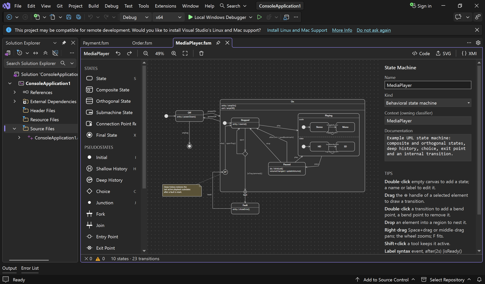
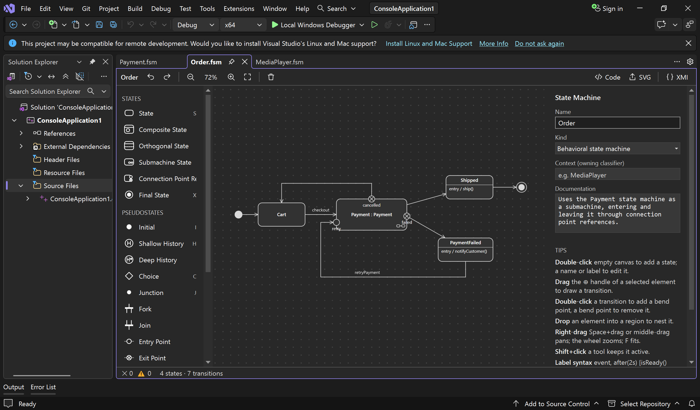
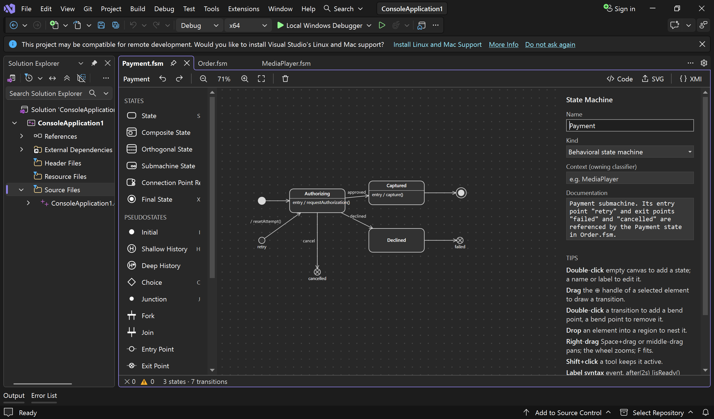

# FSM Editor — UML State Machines & Code Generation for Visual Studio

[](https://marketplace.visualstudio.com/items?itemName=VinceGoSoftware.fsm-editor-vs)

A visual editor and code generator for UML 2.5.1 state machines in Visual Studio 2022 and later. Draw a machine in any `*.fsm` file, with a toolbox, a properties panel, live validation in the Error List and SVG and PNG export, then generate its source code from templates, in Visual Studio or with the bundled `fsm` command-line generator. A machine is two JSON files: `Name.fsm`, the model, readable and editable by hand (elements are identified by their names), and `Name.fsm.layout` beside it, the drawing. Changes to a machine can be reviewed and merged as diagrams, side by side.

This is the Visual Studio edition of [FSM Editor for VS Code](https://github.com/vincedupuis/fsm-editor-vscode). Both editors use the same file format, rules and code generator, so a team can edit the same `.fsm` files in either, and copy and paste diagram elements between them.



## Code generation

*Generate Code...* turns a machine into source code with a [Jinja](https://jinja.palletsprojects.com/) template, running `fsm`, the command-line generator of FSM Editor ([fsm-cli](https://github.com/vincedupuis/fsm-cli)), which the extension bundles. One template can write several files per machine. Two templates are bundled, TypeScript (`ts`) and C++17 for [Boost.SML](https://github.com/boost-ext/sml) (`sml`), and any `*.jinja` template of your solution can be used. The same generator runs from a terminal or a build:

```sh
fsm write "models/**/*.fsm" --template ts --out src/generated
```

See **[docs/CODEGEN.md](https://github.com/vincedupuis/fsm-editor-vs/blob/main/docs/CODEGEN.md)** for the dialog, the Command Window arguments, builds, and where templates and the code model are documented.

## Trace Player

**Tools › FSM Editor › Open Trace...** (or the **Trace** button of the diagram's toolbar, which shows the **Trace Player** window, also in **View › Other Windows**) replays logs of your running state machines on their diagrams: the active states, the transitions taken by the current step, and the branches chosen at choices and junctions. Open several logs at once for concurrent machines: the Trace Player merges them on one timeline by their timestamps. Step through the records, drag the timeline, play them back at a chosen speed, or turn on **Live** to follow the files as your application writes them (playing to the end turns it on).

A submachine state shows as active in its parent's diagram, and the states inside it light up in the submachine's own diagram when that file is open. When a machine runs several times at once (several logs, or a submachine used by several states), each instance has its own color in the diagram, shown in the status bar and in the window's records.

The generated code reports what it does through an `onTrace` hook (see [Tracing](https://github.com/vincedupuis/fsm-cli/blob/main/docs/CODEGEN.md#tracing)); have it write lines in the built-in format, after any prefix your logger adds:

```
2026-11-11T10:02:03.120Z INFO fsm Order event checkout checkout
2026-11-11T10:02:03.121Z INFO fsm Order transition Cart#1 Cart -> Payment (checkout)
2026-11-11T10:02:03.121Z INFO fsm Order.Payment enter Authorizing Authorizing
```

That is `fsm <machine> <kind> <id> <name>`, with `kind` one of `event`, `enter`, `exit`, `transition`, and an optional ISO 8601 time (or time of day) earlier on the line. `examples/demo.log` replays the three examples. Other logs are read with the formats of **Tools › Options › FSM Editor › Trace formats**, a JSON array of formats whose rules are regular expressions with named groups giving the record, for example:

```json
[
  {
    "name": "My service",
    "time": "^(?<time>\\S+)",
    "rules": [
      { "kind": "event", "match": "received (?<name>\\w+)" },
      { "kind": "enter", "match": "entering (?<name>[\\w:]+)" },
      { "kind": "transition", "match": "(?<source>\\w+) -> (?<target>\\w+)" }
    ]
  }
]
```

Groups: `time`, `machine` (the machine's name, then the submachine states leading to a submachine: `Order.Payment`), `id` (the element's id, derived from the names: `Off`, `Paused#2`, `On.fault`; see the file format), `name` (a name or a path of names such as `On::Playing`), `source` and `target` (a transition by its ends, through any pseudostates between them), and `kind` when the rule doesn't give one. When the lines of a log name no machine (and its format gives none), the Trace Player asks which machine they are about; click the machine next to the log in the window to change it. A log with transitions but no `enter` lines still shows the active states, from the transitions' targets.

## UML support

The editor covers UML 2.5.1 state machines: composite, orthogonal and submachine states, all pseudostates, connection point references, entry/exit/do behaviors, deferrable events, the external, local and internal transition kinds, time triggers, and protocol state machines. A validator checks the well-formedness rules as you edit.

Behaviors and conditions are argument-less function calls (`rewind(); showTime()`, `hasDisc() && !isJammed()`), and triggers are event names or `after(2s)`.

Submachine states reuse another state machine file. They're entered and left through connection point references bound to that machine's entry and exit points:





Text that breaks the rules is refused as you type, and the validator flags problems on the diagram, in the editor's status bar and in the Error List.

See **[docs/UML-CONFORMANCE.md](https://github.com/vincedupuis/fsm-editor-vs/blob/main/docs/UML-CONFORMANCE.md)** for the supported features, the text syntax, submachines, the file format, the deviations from UML 2.5.1 and every validation rule.

## Using the editor

- **Add elements**: click a toolbox item and then the canvas, or drag it onto the canvas. Drop an element entirely inside a region to nest it. A composite state moves by its title bar: dragging inside its regions draws a selection band. Double-click empty canvas to add a state.
- **Nesting**: an element inside a composite state stays in its region. Dragging or resizing it past the region's border grows the region, its state and the states around it, and moving back during the same drag shrinks them again. Right-click it and choose *Leave Parent* to move it up one level, to the region holding its state. Overlapping elements get a warning on the diagram.
- **Transitions**: select an element and drag its ⊕ handle to the target, or use the Transition tool (T). Drawing from a comment attaches the comment instead. Drag an end of a selected transition onto another element to move its source or target there.
- **Labels**: double-click a name or transition label to edit it in place. The transition syntax is `event, after(2s) [isReady() && !isBusy()] / doIt(); log()`.
- **Routing**: double-click a transition to add a bend point, double-click a bend point to remove it, and drag labels to move them.
- **Regions**: use the Add Region tool (R) or the properties panel. Each region has its own size: drag the line between two regions to resize the one before it. Resizing the state on the side of its first or last region resizes that region.
- **Groups**: select elements in the same region, right-click one of them and choose *Group*, or press G. Selecting a member of a group shows a dotted rectangle around the group, and dragging it moves the whole group, into a composite state's region as well. *Ungroup*, or G again, dissolves the groups of the selected elements. A click selects a single member, for its properties, Delete or Copy. Groups are flat: grouping elements of different groups merges them into one.
- **Extract to Submachine**: select elements of one region, or one composite state, right-click one of them and choose *Extract to Submachine…*. They move to a new state machine file next to this one, and a submachine state referencing it takes their place, with connection points for the transitions that crossed the boundary. The menu item is greyed out, with the reason in its tooltip, when the selection can't be extracted. See the [conformance doc](https://github.com/vincedupuis/fsm-editor-vs/blob/main/docs/UML-CONFORMANCE.md#submachines-and-connection-point-references).
- **Align**: select elements, right-click one of them and choose *Align Horizontally* (on its horizontal center line) or *Align Vertically* (on its vertical one). Points on a state's border don't align. The elements keep their regions: a composite state grows when its region no longer holds them. An element that is the only selected member of its group brings the whole group along; select several members of a group, or the anchor's group, to align them within it.
- **Colors**: in the properties panel, *Color* colors the selected element, and the swatch beside an entry, exit, do, deferrable events, invariant, trigger, guard or action field colors just that text. A composite state has a *Title color* (its outline, text and header) and a *Background color* (its regions) instead. *Default* removes the color.
- **View**: right-drag, middle-drag or Space+drag pans, the mouse wheel zooms (Shift+wheel pans sideways), F fits the diagram.
- **Properties window**: right-click an element, or empty canvas for the state machine, and choose *Properties…* (or Alt+click or middle-click an element) to edit its properties in a window next to the pointer, without the properties panel. It closes with Esc or a click outside it. *Delete* in the same menu deletes the selection.
- **Panels**: the toolbox and the properties panel work like tool windows. The pushpin auto-hides a panel to a tab on the editor's edge (hover over it or click it to slide the panel out), ▾ Window Position also floats it over the diagram, and ✕ closes it. The two buttons at the right of the toolbar show them again. The layout applies to every diagram.
- **Editing**: Delete removes the selection. Ctrl+C/X/V copies, cuts and pastes, including between diagrams and with VS Code. Ctrl+D duplicates. *Cut*, *Copy* and *Paste* are also in the context menu, which pastes where you right-clicked. Undo and redo (Ctrl+Z, Ctrl+Y) cover the model and its layout: a move is undone like any other change, and saving writes both files.
- **Shortcuts**: S state, X final, I initial, H history, C choice, J junction, N comment, T transition, R region, G group/ungroup, V/Esc select. Shift+click a tool to keep it active.
- **Submachines**: Alt+double-click a submachine state, or use the button in its properties, to open the referenced machine.

Commands (**Tools › FSM Editor**, and the context menus of `.fsm` files in Solution Explorer and of the document tab): *New State Machine...*, *Generate Code...*, *Export as SVG...*, *Export as PNG...*, *Open as Text*, *Open in FSM Editor*, *Compare as Diagrams*. *New State Machine...* is also on the context menu of projects and folders. **File › New › File...** and **Add › New Item...** (General, C#, Visual Basic and C++ projects) also list a *State Machine* template: in a project it adds both files; **File › New › File...** creates the model file, and the layout file is written beside it at the first save.

## Files

A machine `Order` is `Order.fsm`, the model, and `Order.fsm.layout` beside it, the drawing. Both are JSON, and the diagram edits them together: moving an element changes only the layout file, and undo and save cover both. Renaming `Order.fsm` in Solution Explorer, or in the Folder View of an open folder, takes `Order.fsm.layout` with it. AutoRecover (**Tools › Options › Environment › AutoRecover**) backs up a diagram's unsaved changes, and offers them back when Visual Studio ended without saving them. The model file is meant to be read, reviewed and edited by hand:

```json
{
  "version": 1,
  "name": "Order",
  "type": "behavioral",
  "initial": { "target": "Cart" },
  "elements": [
    {
      "name": "Cart",
      "type": "state",
      "transitions": [
        { "type": "external", "trigger": "checkout", "target": "Payment" }
      ]
    },
    …
```

Elements are identified by their names, which are unique in the machine and have no spaces. Elements you don't name (choices, final states, comments…) get a generated name ending with `*`, which the diagram doesn't show. *Open as Text* opens the model file in Visual Studio's JSON editor, checked and completed against the format's JSON Schema, as a `.fsm.layout` file is against the layout file's (when the diagram has unsaved changes, which the file doesn't hold yet, it offers to save them first; the diagram closes, as the two can't share the document), and *Open in FSM Editor* brings the diagram back. A file that isn't valid JSON, or has the wrong shape, shows its problems with their lines instead of the diagram, and in the Error List. A model and a layout file that disagree (a hand edit, a merge, a lost layout file) are reconciled: elements without a place are placed automatically, and nothing in the model is ever dropped. The format is described in [fsm-cli's README](https://github.com/vincedupuis/fsm-cli#the-fsm-file-format) and in [docs/UML-CONFORMANCE.md](https://github.com/vincedupuis/fsm-editor-vs/blob/main/docs/UML-CONFORMANCE.md#file-format).

Files of earlier versions (XMI 2.5.1 with UML DI) still open, unchanged (opening one doesn't mark it as changed): saving one after a change writes the new format, converting the files linked to it by submachine states at the same time, and says what was renamed or left out. *Open as Text* opens them in the XML editor.

## Diagram diff and merge

**Diff.** *Compare as Diagrams* (the context menu of a `.fsm` file in Solution Explorer or of its document tab, or **Tools › FSM Editor**) opens the file's version in Git and the file as diagrams side by side: the older one on the left, read-only, the file on the right, editable. The older version is the one in the index when the file has changes not staged yet, else the last commit's. Added elements are marked on the right, removed ones on the left, changed ones on both; select a changed element to see what changed in it (guard, action, target…). ◀ ▶ step through the changes, and the two diagrams scroll and zoom together. Changes of the drawing alone (positions, routes, colors) aren't marked unless you tick *Show layout changes*. Elements are matched by name, transitions by source, trigger and target: a renamed state shows as one removed and one added. An older version without its layout file is drawn where the newer one places the same elements. An old-format file compares with its converted version.

**Merge.** A `.fsm` file with merge conflicts (after a merge, rebase or cherry-pick) opens as three diagrams: the result (the file, starting as the current side, and marked as changed only once you choose), and the **Incoming** and **Current** sides beside it, read-only. The conflicts, the differences between the two sides, are listed and marked: take each from incoming or keep it current, or all at once, then **Complete Merge**, which saves both files without markers and marks them resolved in Git. When Git gives the common version, the changes each side made, which Git merged by itself, are marked lightly. When a side of the conflicts isn't a valid machine file, the diagram shows why, with a button to open the file as text, where Visual Studio's merge editor can resolve it. A conflict in the layout file alone opens the diagram with the current positions; saving writes a clean layout file.

## Development

Requirements: Windows with Visual Studio 2022 (17.0 or later) and the *Visual Studio extension development* workload; [Rust](https://rustup.rs/) to build fsm-editor-common's sidecar from clones of [fsm-editor-common](https://github.com/vincedupuis/fsm-editor-common) and [fsm-cli](https://github.com/vincedupuis/fsm-cli), or else the archives of an [fsm-editor-common release](https://github.com/vincedupuis/fsm-editor-common/releases).

```powershell
scripts\fetch-common.ps1     # copies fsm-editor-common.exe, fsm-cli's templates, the schemas and the interface's cases from clones
                             # (..\fsm-editor-common, ..\fsm-cli) into src\FsmEditor.Vsix\cli (-Build builds it there first with
                             # cargo; -Source takes a folder of the release's archives, unpacked, instead)
dotnet test                  # the client of fsm-editor-common (its interface's cases), editing, extraction and trace tests
```

Open `FsmEditor.sln`, set **FsmEditor.Vsix** as the startup project and press F5 to start the Visual Studio experimental instance, then open `examples\MediaPlayer.fsm`, or `examples\Order.fsm` for a submachine with connection point references (it uses `examples\Payment.fsm`). Building in Release produces `src\FsmEditor.Vsix\bin\Release\net48\FsmEditor.vsix`; double-click it to install it.

To publish, build in Release (it fails if `fsm-editor-common.exe` hasn't been fetched), then upload the `.vsix` with `vs-publish.json`, which describes the Marketplace listing and uses this README as its page:

```powershell
& "$env:VSINSTALLDIR\VSSDK\VisualStudioIntegration\Tools\Bin\VsixPublisher.exe" publish `
  -payload src\FsmEditor.Vsix\bin\Release\net48\FsmEditor.vsix -publishManifest vs-publish.json -personalAccessToken <token>
```

Bump the version in `source.extension.vsixmanifest`, `FsmEditor.Vsix.csproj` and `InstalledProductRegistration` in `FsmEditorPackage.cs` first.

Pushing a version tag (`git tag v0.3.3 && git push origin v0.3.3`) also builds the `.vsix` on GitHub Actions (`.github/workflows/release.yml`, which bundles the fsm-editor-common release set in `FSM_COMMON_VERSION`) and attaches it to the GitHub Release of that tag. The tag must match the manifest version.

On macOS or Linux, `dotnet build` compiles every project (the VSIX packaging steps only run on Windows) and `dotnet test` runs the tests.

### Layout

- `src/FsmEditor.Core/` (.NET Standard 2.0, no Visual Studio dependency): the model (`Model.cs`, its JSON in `ModelJson.cs`), the client of fsm-editor-common's sidecar (`Common.cs`) and what goes through it: the text grammar's checks (`Expressions.cs`), the file format (`Format.cs`, `MachineFiles.cs`), converting files of earlier versions (`Conversion.cs`, `Load.cs`), comparing and merging versions (`Compare.cs`, `Merge.cs`; the panes' logic in `Sessions.cs`), the validator (`Validation.cs`); diagram geometry (`Geometry.cs`, `Labels.cs`), every editing operation of the diagram (`DiagramSession.cs`, `Tools.cs`), SVG export, the clipboard format, submachine resolution (`Workspace.cs`) and the Trace Player's logic (`Trace.cs`)
- `src/FsmEditor.Vsix/`: the Visual Studio extension
  - `FsmEditorPackage.cs`: registration, the Error List providers, SVG and PNG export and the code generation flow
  - `Editor/FsmDocument.cs`: the document data, the model and layout files with their undo history, saving and conversion
  - `Editor/FsmEditorFactory.cs`, `Editor/FsmEditorPane.cs`: the document window; syncs the document and the diagram
  - `Editor/DiagramSessions.cs`: the diagram diff and merge panes
  - `Editor/EditorControl.cs`, `Editor/DiagramCanvas.cs`, `Editor/PropertiesPanel.cs`: the WPF diagram editor
  - `Services/`: open documents, the solution's machines, the Error List, dialogs, Git, the JSON text view and the files' JSON Schemas, layout files renamed with their models
  - `CodeGen/`: code generation through fsm-editor-common, and its dialog
  - `TracePlayer/`: the Trace Player tool window and the service following the logs
  - `Commands/`, `VSCommandTable.vsct`: menu commands
- `test/FsmEditor.Core.Tests/`: tests, which run fsm-editor-common's sidecar (`FSM_EDITOR_COMMON`, else the one `scripts/fetch-common.*` copied) and replay its interface's cases
- `scripts/fetch-common.*`: copies fsm-editor-common's sidecar, fsm-cli's templates, the schemas and the interface's cases into `src/FsmEditor.Vsix/cli`
- `vs-publish.json`: the Marketplace listing; `images/`: the README's screenshots
- `docs/`: UML conformance and code generation
